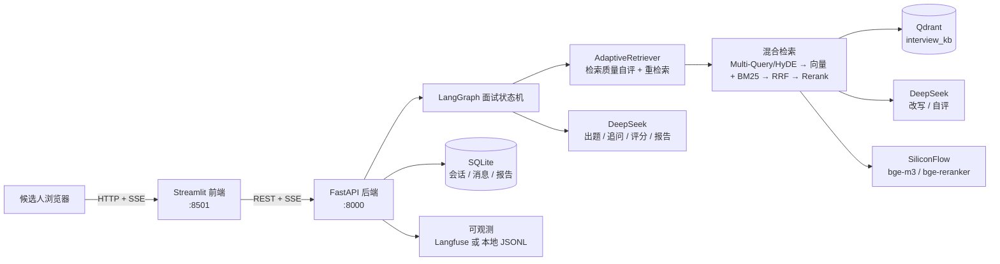

# AI 模拟面试官（Agentic RAG + LangGraph）

> 把「岗位 JD + 简历 + 八股题库」做成可溯源知识库，用 DeepSeek 扮演面试官：
> **出题 → 作答 → 评分 → 追问 → 总结报告**全流程由 LangGraph 状态机编排，检索采用
> **查询改写 + 向量/BM25 混合召回 + RRF 融合 + Rerank 精排**，并在上下文不足时由 LLM
> **自评触发重检索**（Agentic RAG）。附带 RAGAS 离线评测与 Langfuse/JSONL 全链路可观测。

技术栈：Python 3.11 · FastAPI · LangGraph · DeepSeek · SiliconFlow(bge-m3 / bge-reranker) ·
Qdrant · rank-bm25 + jieba · Streamlit · Docker Compose。

---

## 1. 架构与数据流



**一次面试的数据流**：

1. 前端创建会话（可选上传简历 / JD）→ 后端把上传文档解析、切块、embedding 后写入 Qdrant（`kb_type` 区分 `resume` / `jd` / `qa`）。
2. 候选人发送消息 → `POST /sessions/{id}/messages` 返回 **SSE 流**，逐 token 推送面试官文本。
3. 图节点 `ask_question` 调 **AdaptiveRetriever**：先按岗位/简历生成查询（Multi-Query，可选 HyDE）→ 向量路召回 + BM25 路召回 → RRF 融合 → Rerank 取 Top-K → LLM 自评「上下文是否足够」，不足则改写查询重检索（默认最多 2 轮）。
4. 候选人作答 → `assess_answer` 评分（`good`/`partial`/`poor`）→ 条件路由：追问 / 下一题 / 结束。
5. 结束（答满题目或前端点「提前结束」）→ `final_evaluation` → `report`，生成含雷达图与改进建议的 Markdown 报告，落库并返回。

**LangGraph 状态机（节点与条件边）**：

```
START ─┬─ greeted? ── greeting → ask_question → END
       ├─ pending_answer? ── receive_answer → assess_answer ─┬─ 追问 → followup → END
       ├─ finish_requested? ── final_evaluation → report → END
       └─ done? ── END
```

`assess_answer` 后三条条件边：`followup`（本答案质量是 partial/poor 且有追问且未超上限）、
`next`（继续下一题）、`finish`（题目答满）。

## 2. 技术栈与选型

| 层 | 选型 | 关键点 |
| --- | --- | --- |
| 后端 | FastAPI + Uvicorn | 异步 + SSE 流式；`/health` 组件级探活 |
| Agent 编排 | LangGraph | 显式节点/条件边 + 状态快照持久化（可恢复/断点续跑） |
| LLM | DeepSeek（OpenAI 兼容） | 出题/追问/评分/改写/自评分工，统一超时与退避重试 |
| Embedding / Rerank | SiliconFlow `bge-m3` / `bge-reranker-v2-m3` | 1024 维；两阶段「粗召回 → 交叉编码精排」 |
| 向量库 | Qdrant | local 文件模式（开发）/ server 模式（Docker）；幂等 upsert |
| 关键词检索 | rank-bm25 + jieba | 中文分词，heading + text 参与打分 |
| 融合 | RRF（k=60） | 免训练、解决向量分与 BM25 分尺度不可比 |
| 存储 | SQLite | 会话、消息、状态快照、报告 |
| 前端 | Streamlit | 三页式（开始 / 面试 / 报告） |
| 评测 | RAGAS 0.4 | LLM-as-judge，固定 judge 与阈值 |
| 可观测 | Langfuse 或 本地 JSONL | 同一 `SpanRecord` 结构，未配 key 自动降级 |
| 部署 | Docker Compose | 三容器（qdrant / api / streamlit），非 root，健康检查 |

## 3. 快速开始（Windows 本地）

前置：Python 3.11、[uv](https://docs.astral.sh/uv/)、DeepSeek 与 SiliconFlow 的 API Key。
本地开发默认 `QDRANT_MODE=local`（Qdrant 以本地文件模式运行，**无需安装 Docker**）。

```powershell
# 1) 安装依赖
uv sync                    # 基础依赖
uv sync --extra eval        # 可选：需要跑 RAGAS 评测时
uv sync --extra obs         # 可选：需要上报 Langfuse 时

# 2) 配置密钥
Copy-Item .env.example .env
# 编辑 .env，至少填写 DEEPSEEK_API_KEY 与 SILICONFLOW_API_KEY

# 3) 验活三个外部接口（chat / embedding / rerank）
uv run python scripts/check_models.py

# 4) 摄入知识库（简历 / JD / 题库 → Qdrant）
uv run python scripts/ingest_kb.py --rebuild

# 5) 启动后端与前端（两个终端）
uv run uvicorn app.main:app --reload --port 8000
uv run streamlit run frontend/app.py
# 浏览器打开 http://localhost:8501
```

`GET http://localhost:8000/health` 返回组件状态；未配 key 时进程仍存活，整体标记 `degraded`。

## 4. 目录结构

```
app/
  config/        集中配置（pydantic-settings，启动期校验、密钥不入日志）
  core/          LLM / Embedding / Reranker 客户端 + 统一异常与重试
  rag/           loader / chunker / ingestion / bm25 / fusion(RRF) / rewrite / retriever / adaptive
  agent/         LangGraph 图与节点（graph.py）+ 状态（state.py）+ 报告（report.py）
  api/           health / sessions（SSE）/ schemas / deps / errors
  storage/       qdrant_store（向量库访问层）+ db（SQLite）
  observability/ tracer + Langfuse sink + JSONL sink
  eval/          dataset / runner / generator / refusal / metrics_ragas / report
frontend/        Streamlit：app.py + api_client + ui_common + views_{start,interview,report}
scripts/         check_models.py / ingest_kb.py / run_eval.py
data/            knowledge（简历/JD/题库）、eval（评测集与报告）、reports
tests/           离线单测 + 集成测试（-m integration）
deploy/          deploy.sh（Linux 一键部署）
```

## 5. 接口

| 方法 | 路径 | 说明 |
| --- | --- | --- |
| `GET` | `/health` | 组件健康状态（配置 + Qdrant 连通），HTTP 200 = 进程存活；整体 `healthy`/`degraded` |
| `POST` | `/sessions` | 创建会话（multipart：`track`、`num_questions`、`candidate_name`，可选 `resume`/`jd` 上传）；返回 201 + `SessionRecord` |
| `POST` | `/sessions/{id}/messages` | 提交消息，返回 `text/event-stream`；`content` 为空且未开始 → 开场 + 第一题 |
| `POST` | `/sessions/{id}/finish` | 提前结束并生成报告；已结束会话幂等返回既有报告 |
| `GET` | `/sessions/{id}` | 会话详情 + 消息列表 |
| `GET` | `/sessions/{id}/report` | 获取报告；未生成返回 404 `REPORT_NOT_FOUND` |

**SSE 事件**：`stage`（阶段推进，含轮次）、`token`（面试官文本增量）、`done`（本轮结束，`error` 时标注）、`error`（中文可读错误码，不断开连接）。

## 6. 评测方法与当前指标

评测集 `data/eval/eval_dataset.json` 共 **43 条**，覆盖四类：简历（10）、中文/英文 JD（各 5，共 10）、
技术题库（16）、**题库外诱导题**（7，考查拒答）。脚本：`uv run python scripts/run_eval.py`。

- **RAGAS 四指标**（LLM-as-judge，judge=`deepseek-chat`，固定 `temperature=0`、`max_tokens=4096`）：
  `faithfulness`、`context_precision`、`context_recall`、`answer_relevancy`；`oos` 诱导题不打分。
- **检索侧**：期望来源命中率、平均上下文数、平均自适应轮数。
- **拒答**：诱导题（题库外）应拒答，非诱导题**不应误拒答**。

**当前基线（`data/eval/baseline.json`，2026-10-16，adaptive=True / top_k=6）**：

| 指标 | 得分 | 阈值 | 达标 |
| --- | --- | --- | --- |
| faithfulness | **0.985** | 0.85 | ✅ |
| context_precision | 0.912 | （观察项） | — |
| context_recall | **1.000** | 0.80 | ✅ |
| answer_relevancy | **0.872** | 0.85 | ✅ |

检索侧：期望来源命中率 **100%**、平均上下文 6.0 条、平均自适应轮数 **1.58**；
题库外诱导题拒答率 **100%**（目标 ≥80%），非诱导题误拒答率 **0%**。
报告随评测自动渲染为 Markdown/JSON，写入 `data/eval/reports/`。

### 6.1 检索管线消融对照（同一 43 条评测集，2026-10-17）

固定生成与评判参数，仅逐档叠加检索组件，观察各组件的**边际贡献**
（`uv run python scripts/run_ablation.py`，报告 `data/eval/reports/ablation_*.md`）：

| 档位 | 来源命中率 | faithfulness | context_precision | context_recall | answer_relevancy | 每问耗时(s) | 总token | 成本(元/问) |
| --- | --- | --- | --- | --- | --- | --- | --- | --- |
| dense（仅向量） | 100% | 0.974 | 0.819 | 1.000 | 0.882 | 0.31 | 41644 | ¥0.0025 |
| +bm25（朴素拼接融合） | 100% | 0.984 | 0.824 | 1.000 | 0.891 | 0.36 | 41706 | ¥0.0025 |
| +RRF | 100% | 0.985 | **0.925** | 1.000 | 0.880 | 0.45 | 42871 | ¥0.0026 |
| +rerank | 100% | 0.966 | **0.935** | 1.000 | 0.883 | 0.38 | 44677 | ¥0.0027 |
| +agentic（改写 + 自评重检索） | 100% | 0.981 | 0.937 | 0.993 | 0.883 | 2.28 | 87572 | ¥0.0058 |

读数（结论如实标注）：
- **RRF 是 `context_precision` 的主要贡献项**：0.824 → 0.925（+0.101，相对 +12%），远大于 BM25 单路（+0.005）
  与 rerank（+0.010）的增量——本场景的收益主要来自**融合排序**，而非「多一路召回」或「精排」本身。
- **Agentic 档在本评测集上边际收益为负**：`context_precision` 仅再 +0.002，却把每问耗时从 0.38s 拉到 2.28s（≈6×）、
  成本从 ¥0.0027 拉到 ¥0.0058（≈2.2×），且 `context_recall` 由 1.000 略降至 0.993。保留它的理由是它针对
  **评测集覆盖不到的失败模式**（知识库确有答案、但首轮未召回），属**鲁棒性冗余而非精度提升**，见 §7。
- **局限**：来源命中率在所有档位均为 100%，说明该评测集对检索变体已**饱和**、不足以区分优劣，故以
  `context_precision` 作主信号；且各档独立重新生成答案（`temperature=0.1`），`faithfulness`/`answer_relevancy`
  的档间差异（±0.02 内）含生成随机性，不宜过度解读。

### 6.2 真实面试会话：成本与延迟实测（6 场 × 5 题，2026-10-17）

在真实模型（DeepSeek chat + SiliconFlow bge-m3 / bge-reranker）与真实多轮链路上跑 6 场完整面试
（开场 → 交替出题/作答/追问 → 终评 → 报告），再从本项目**自身埋点**聚合
（`uv run python scripts/measure_session_cost.py`，报告 `data/eval/reports/session_cost_*.md`）：

| 指标 | 实测值 |
| --- | --- |
| 单场总 token | 12,760 – 16,545（均值 ≈ 14.6k） |
| 单场成本（deepseek-chat 全价、缓存未命中） | **均值 ¥0.052**，中位 ¥0.051，区间 ¥0.046 – ¥0.060 |
| 单场端到端耗时 | 均值 48.7s，P50 48.9s，最大 51.3s |
| 单轮成本（每场 6 轮） | ≈ ¥0.0087 |

阶段耗时（毫秒，均值 / P95）：

| 阶段 | 均值 | P95 | 说明 |
| --- | --- | --- | --- |
| `ask_question` | 10,736 | 11,758 | 出题：改写 + HyDE → 向量 + BM25 → RRF → rerank → 生成；**用户感知首字延迟的大头** |
| `report` | 7,088 | 8,632 | 终评报告（一次长生成） |
| `assess_answer` | 1,365 | 1,645 | 单次回答评估 |
| `greeting` | 1,158 | 1,565 | 开场 |
| 单次 LLM 调用 | 1,424 | 1,843 | 全链路 P50 1,235ms |
| 单次 rerank | 458 | 741 | 交叉编码器精排 |

token 按用途拆分：`eval`（评估 + 报告）96 次调用共 64.9k token，`question` 24 次共 10.6k，`rewrite` 54 次共 10.3k。

读数与结论：
- **成本不是瓶颈**：一场 50 秒、5 题的真实面试全价约 **5 分钱**——这套「重检索、重评判」的架构在成本上完全可承受，
  「宁可多花召回/评判开销换质量」的取舍因此成立。
- **延迟瓶颈在出题阶段的串行 LLM/embedding 往返**，而非向量库或本机算力：`ask_question` 的 10.7s 里绝大部分是
  多查询改写（2 次 LLM）+ 多路 embedding + 生成，rerank 仅 0.46s。若要提速，优先级是**改写与 embedding 并发 +
  改写结果缓存**，而不是换向量库。

### 6.3 Judge 自评偏置治理：异源 judge 交叉验证（同一 36 条生成结果，2026-10-18）

上面的指标都由 LLM-as-judge 给出，而默认 judge（`deepseek-chat`）与线上打分/出题模型**同源**，
存在「自评偏置」的质疑——自评模型可能系统性抬高与自己风格相近答案的分数。
为量化这一点，本项目把 **同一批生成结果**（不重新生成，差异只归因于 judge）交给两个 judge 各打一遍分：

- **自评 judge**：`deepseek-chat`（同源，即现有基线所用）；
- **异源 judge**：`Qwen/Qwen2.5-72B-Instruct`（**另一厂商 SiliconFlow + 另一模型族**，经实测支持 function calling，可从 ragas instructor 路径打分）。

脚本 `uv run python scripts/run_judge_cross_check.py`，报告 `data/eval/reports/judge_cross_check_*.md`；
覆盖 **36 条非诱导题，144 个「指标×样例」单元，0 缺失**（`n_missing=0`）。判定口径 |Δ|≤0.1 记为「一致」，Δ = 自评 − 异源（>0 = 自评偏高）。

| 指标 | 自评均值 | 异源均值 | Δ(自评−异源) | 平均绝对差 | ≤0.05 一致 | ≤0.10 一致 | Pearson |
| --- | --- | --- | --- | --- | --- | --- | --- |
| faithfulness | 0.973 | 1.000 | **-0.027** | 0.027 | 80.6% | 88.9% | — |
| context_precision | 0.928 | 0.914 | **+0.015** | 0.024 | 88.9% | 91.7% | 0.866 |
| context_recall | 1.000 | 1.000 | **0.000** | 0.000 | 100.0% | 100.0% | — |
| answer_relevancy | 0.899 | 0.790 | **+0.108** | 0.112 | 36.1% | 55.6% | 0.638 |

全体 144 个单元：|Δ|≤0.05 一致率 **76.4%**，|Δ|≤0.10 **84.0%**，|Δ|≤0.20 **93.8%**。

读数（结论如实标注，不美化）：
- **三项指标对换 judge 稳健**：`faithfulness`（Δ=-0.027，异源更宽松）、`context_precision`（Δ=+0.015，Pearson 0.866）、
  `context_recall`（**逐条完全一致**）——这些指标**没有**被自评模型抬高，自评偏置可忽略。
- **`answer_relevancy` 是唯一显著受 judge 影响的指标**：自评比异源**高 0.108**，逐条一致率仅 55.6%、Pearson 0.638。
  原因可解释：该指标依赖「让 judge 反推人造问题 + embedding 相似度」，对 judge 的语气/切题判准更敏感，
  被测模型（同源）系统性更「宽容」。**因此 `answer_relevancy` 的绝对值应谨慎解读**，更宜作趋势信号而非硬门槛。
- **配套改动**：新增独立 judge 配置 `EVAL_JUDGE_MODEL / EVAL_JUDGE_BASE_URL / EVAL_JUDGE_API_KEY`（留空则回落到
  `LLM_MODEL_EVAL`/DeepSeek，**线上零行为变化**）；跨厂商 judge 有 TPM 限速，脚本对限流失败做指数退避重试并按需串行。

## 7. 关键设计取舍

- **为何混合检索（向量 + BM25 + RRF）**：Embedding 是语义模糊匹配，对错误码、型号、专有名词等
  **精确关键词不敏感**；BM25 补精确匹配。两路分数**尺度不可比**，故用 RRF 按「排名」融合而非按分数加权，
  免训练、对异常分值鲁棒。
- **为何两阶段「粗召回 → Rerank」**：双塔向量检索快但 query 与文档无交互；Rerank 用交叉编码器
  对 query+候选联合建模更准但更贵。先粗召回几十条再精排取 Top-K，兼顾效果与成本。
- **为何 Agentic RAG（自评 + 重检索）**：单轮检索最大的失败模式是「知识库有答案但没召回」。
  由 LLM 依据「问题 + 召回上下文」自评是否足够，不足则改写查询重检索（默认 ≤2 轮）；
  设 **最大轮数上限**、非法输出**重试一次后保守放行**、且**返回各轮 Top-1 最优结果**，避免死循环与更差结果。
- **为何 LangGraph 而非裸 ReAct**：面试流程是**确定性强状态机**（出题→作答→评估→追问/下一题→报告），
  用显式节点 + 条件边而非 LLM 自由决策工具循环，**稳定、可控、可测试**；状态快照持久化支持
  进程重启后**恢复会话**与前端断线续接。
- **为何 Qdrant 同城/本地双模式**：开发用 `local` 文件模式零依赖，部署用 `server` 模式命名卷持久化；
  访问层统一，避免环境分叉。
- **可观测为何「同结构双后端」**：统一 `SpanRecord`（trace/span/parent/kind/耗时/字段），
  配了 Langfuse 就上报，没配就写 `logs/traces.jsonl`——**业务代码零侵入**（上下文管理器/装饰器），
  面试官只要一个 `trace_id`（= `session_id`）就能串起改写、双路召回计数、rerank、自评结论、图节点与 LLM 调用耗时。
- **为何「实测 agentic 档边际收益为负」仍保留它**：§6.1 的消融显示自适应重检索在本评测集上只把
  `context_precision` 提高 0.002，却让每问耗时与成本增加约 2–6 倍。保留的判据是**收益随失败模式分布而变**：
  评测集是「已知有答案、且能被召回」的样本，测不出它要解决的「首轮召回失败」场景。用可控成本换线上尾部风险下降，
  比刷评测集均值更重要——这也是把「消融结论」与「上线决策」分开的一个例子。
- **为何要做「异源 judge 交叉验证」，而非只信一套 LLM 评分**：LLM-as-judge 的分数是**工具**不是**真理**。
  默认 judge 与线上模型同源，会招致「自己给自己打分」的质疑。做法是保留默认 judge 作基线，同时引入**另一厂商、
  另一模型族**的 judge，对**同一批生成结果**再打一遍分，用 Δ 与逐条一致率把偏置**量化**出来（§6.3）。
 结论是三项指标稳健、`answer_relevancy` 自评偏高 0.108——于是对该指标的绝对值保持克制解读。可切换的独立 judge 配置
  （`EVAL_JUDGE_*`）默认留空、线上零变化，需要时才启用。

## 8. 测试与代码质量

```powershell
uv run pytest -q                                  # 全部（含集成，需真实 key 与 Qdrant）
uv run pytest -q -m "not integration"             # 仅离线单测（无需外部服务）
uv run pytest -m integration                      # 仅集成测试（真实 Qdrant + SiliconFlow + DeepSeek）
uv run pytest -q -m "not integration" --cov=app --cov-report=term-missing   # 覆盖率
uv run ruff check app tests frontend              # 静态检查
```

- 离线单测覆盖配置校验、切块/加载、RRF、检索改写开关、自适应循环、图路由、持久化、
  报告渲染、观察性与评测聚合；集成测试用 `-m integration` 标记，与离线用例分离。
- 覆盖率配置见 `pyproject.toml` 的 `[tool.coverage.*]`；核心工具模块均 **≥70%**
  （chunker、RRF、状态路由、schemas、storage、adaptive）。

## 9. 可观测性

- 未配 `LANGFUSE_*` 时：每次面试在 `logs/traces.jsonl` 落一条 `SpanRecord`/span，
  含 `trace_id`（= 会话 ID）、`span_id`/`parent_id`、`kind`、耗时与业务字段。
- 配置 `LANGFUSE_SECRET_KEY` / `LANGFUSE_PUBLIC_KEY` / `LANGFUSE_HOST` 后：同名 trace 可在
  Langfuse UI 按 session 查看；**关闭上报与开启时业务行为逐字一致**（测试覆盖）。

## 10. 部署上线（Docker Compose，面向公网访问）

### 10.1 架构与端口

三个容器由 `docker-compose.yml` 编排，前端是公网唯一入口：

| 服务 | 镜像 | 端口 | 说明 |
| --- | --- | --- | --- |
| `qdrant` | `qdrant/qdrant:v1.19.2` | 6333（仅容器内网） | 向量库；**默认无鉴权，故不发布端口**，仅 `api` 经内部网络 `http://qdrant:6333` 访问 |
| `api` | `ai-interviewer:latest`（多阶段构建） | `127.0.0.1:8000` | FastAPI + Agentic RAG；仅绑定宿主机回环，公网不可直连 |
| `streamlit` | 同一镜像 | `8501` | 前端，公网入口；以 `API_BASE_URL=http://api:8000` 访问后端 |

- 健康检查：`qdrant` 探 TCP 6333；`api` 探 `GET /health`（HTTP 200）；`streamlit` 探 `/_stcore/health`；`depends_on` 用 `condition: service_healthy` 保证启动顺序（Qdrant → API → 前端）。
- 持久化：命名卷 `qdrant_storage`（向量数据）、`app_db`（SQLite 会话/报告）、`app_reports`（Markdown 报告）、`app_logs`（可观测性 JSONL）。
- 知识库文档随镜像分发（非挂载卷），保证容器内 `ingest_kb.py` 读到的始终是本次构建的 `data/knowledge`。

### 10.2 服务器规格

单机演示足够：**2 vCPU / 4 GB 内存 / 40 GB SSD**，系统 Ubuntu 22.04 LTS。

内存给 4 GB 是留余量：三容器常驻（Qdrant + uvicorn + Streamlit）稳态约 1–1.5 GB，2 GB 也能跑，但摄入知识库时容易吃紧。磁盘 40 GB 为舒适线、20 GB 为最低线（基础镜像与 uv 构建缓存约 3–5 GB）。

**腾讯云选购**：优先 **轻量应用服务器（Lighthouse）2 核 4 G + Ubuntu 22.04 镜像**——比 CVM 便宜、控制台更简单（端口放行在「防火墙」里配置，而非「安全组」）。要更规范也可选 CVM 标准型 2C4G（用「安全组」）。带宽 3–5 Mbps 足够（SSE 只推文本 token）。

**访问方式与备案**：直接用 `http://<公网IP>:8501` 访问**无需 ICP 备案**；若要绑定域名走 80/443，则需先完成 ICP 备案。

安全组 / 防火墙入站规则：

| 端口 | 用途 | 建议 |
| --- | --- | --- |
| 22 | SSH | 放行（限制来源 IP 更佳） |
| 8501 | 前端演示 | 放行（对面试官/公网） |
| 8000 | 后端 API | **不放行**（默认仅回环；需要公网调试再自行放开） |
| 6333 / 6334 | Qdrant | **不放行**（无鉴权） |

### 10.3 一次性准备：安装 Docker（国内服务器建议同时配镜像加速）

```bash
curl -fsSL https://get.docker.com | sudo sh                 # 安装 Docker Engine + compose v2
sudo usermod -aG docker "$USER" && newgrp docker             # 免 sudo 使用 docker
docker compose version                                        # 确认 compose 插件可用
```

`deploy/deploy.sh` 只会**检查** Docker 是否可用、缺失时报错提示，**不会自动安装**，所以这一步需先手动完成一次。

**国内服务器两个坑（建议先处理再构建）**：

1. **拉基础镜像慢/超时**：`python:3.11-slim` 与 `qdrant/qdrant` 都来自 Docker Hub，国内直连常失败。配置镜像加速后重启 Docker：

   ```bash
   sudo mkdir -p /etc/docker
   sudo tee /etc/docker/daemon.json >/dev/null <<'EOF'
   {
     "registry-mirrors": ["https://mirror.ccs.tencentyun.com"]
   }
   EOF
   sudo systemctl restart docker
   ```

   `mirror.ccs.tencentyun.com` 是腾讯云内网镜像源（在其云主机上可用）；换成其他厂商/自建加速地址时，只需改 `registry-mirrors` 数组。

2. **构建期从 PyPI 下载依赖**：`Dockerfile` **已内置**国内镜像，无需手工配置——它把 `pip` / `uv` 的索引设为清华 TUNA，并在构建期把 `uv.lock` 内写死的官方 CDN 绝对直链（`files.pythonhosted.org`）改写为同结构的镜像主机。

   后者是必须的：`--frozen` 模式下 `uv` 按锁文件里的 URL **直接下载**，**只设 `UV_INDEX_URL` 不生效**；国内直连该 CDN 实测仅约 70 KB/s，会把依赖层拖到超时（实测 `uv sync` 7 分钟无进展）。

   海外环境或想改回官方源时用构建参数覆盖（`UV_MIRROR_HOST` 需是与官方 CDN 路径结构一致的镜像主机）：

   ```bash
   docker build \
     --build-arg PIP_INDEX_URL=https://pypi.org/simple \
     --build-arg UV_INDEX_URL=https://pypi.org/simple \
     --build-arg UV_MIRROR_HOST=files.pythonhosted.org \
     -t ai-interviewer:latest .
   ```

   > 实测（腾讯云 2C4G / 广州）：改写镜像主机后 `uv sync` **32 秒完成**；镜像文件与官方字节一致，`sha256` 校验不受影响。

### 10.4 配置密钥

```bash
cp .env.example .env
vim .env     # 至少填写 DEEPSEEK_API_KEY 与 SILICONFLOW_API_KEY
```

`.env` 仅通过 compose 的 `env_file` 注入为容器环境变量，**不会进入镜像**（`.dockerignore` 已排除），也不会被 git 跟踪（`.gitignore` 已忽略）。

### 10.5 一键部署（Linux）

```bash
bash deploy/deploy.sh
```

脚本依次执行：检查 Docker → 校验 `.env`（含占位符拦截）→ `docker compose build` → `up -d` → 轮询至三容器 `healthy`（默认上限 300s）→ `check_models.py` 三接口验活 → `ingest_kb.py --rebuild` 摄入知识库 → 打印访问地址。

常用参数：`--no-build`（只重启）、`--skip-ingest`（跳过摄入）、`--help`（含 Windows 用法）。

### 10.6 手动部署（等价步骤）

```bash
docker compose build
docker compose up -d
docker compose ps                                  # 三容器应为 healthy
curl -s http://127.0.0.1:8000/health               # 200 且含 qdrant 状态字段
docker compose exec api python scripts/check_models.py        # chat/embedding/rerank 均可用
docker compose exec api python scripts/ingest_kb.py --rebuild # resume/jd/qa 分类计数
```

### 10.7 验证部署达标

1. `docker compose ps` → `qdrant` / `api` / `streamlit` 三者 `healthy`。
2. 浏览器打开 `http://<公网IP>:8501`，完整走一次：新建会话 → 出题 → 作答 → 追问 → 生成报告。
   - 回答中应能看到知识库引用（示例简历/JD/题库），报告页含雷达图与改进建议。
3. 留痕：`docker compose logs --tail=100 api` 可见 SSE 首字节耗时与检索溯源日志；`docker compose exec api` 查看 `/app/logs/traces.jsonl`。

### 10.8 Windows 本地（Docker Desktop）等价用法

```powershell
Copy-Item .env.example .env      # 填写真实 Key
docker compose build
docker compose up -d
docker compose exec api python scripts/ingest_kb.py --rebuild
# 浏览器打开 http://localhost:8501
```

> 注：Windows 上 Qdrant 若挂载本地目录存在文件系统兼容风险，本项目使用 Docker 命名卷，不挂载宿主目录，规避该问题。

### 10.9 更新、日志、备份

```bash
git pull && bash deploy/deploy.sh --no-build   # 更新代码后重建并重启
docker compose logs -f api                      # 后端日志（含检索/改写/自评结构化输出）
docker compose logs -f streamlit                # 前端日志
docker compose down                             # 停止并移除容器（数据保留在命名卷中）
```

备份（在服务器上导出命名卷内容）：

```bash
docker run --rm -v ai-interviewer_qdrant_storage:/data -v "$PWD":/backup alpine \
  tar czf /backup/qdrant_storage.tar.gz -C /data .
docker run --rm -v ai-interviewer_app_db:/data -v "$PWD":/backup alpine \
  tar czf /backup/app_db.tar.gz -C /data .
```

恢复：将上述归档解回同名卷即可（先 `docker compose down`）。

### 10.10 可选：SSH 公钥免密登录（便于脚本化运维）

腾讯云轻量服务器的网页终端（OrcaTerm）可用，但**长文本粘贴易被截断**；想用脚本化运维建议装公钥后走 `ssh -i`：

```powershell
# 本地生成（Windows PowerShell 需用 --% 才能传空口令）
ssh-keygen --% -q -t ed25519 -N "" -f $env:TEMP\iv_ssh\id_ed25519 -C deploy
```

```bash
# 在服务器网页终端执行一次：把上一步生成的 id_ed25519.pub 内容追加进去
mkdir -p ~/.ssh && chmod 700 ~/.ssh
echo '<id_ed25519.pub 内容>' >> ~/.ssh/authorized_keys && chmod 600 ~/.ssh/authorized_keys
```

之后本地即可非交互执行（无需密码，也不必改用网页终端）：

```powershell
ssh -i $env:TEMP\iv_ssh\id_ed25519 -o BatchMode=yes ubuntu@<公网IP> "cd ~/ai-interviewer && bash deploy/deploy.sh"
```

> 实测提示：国内服务器 `git pull` 偶发 `RPC failed; curl 28 GnuTLS recv error (-110)`，
> 执行 `git config --global http.version HTTP/1.1` 后即可稳定拉取。
